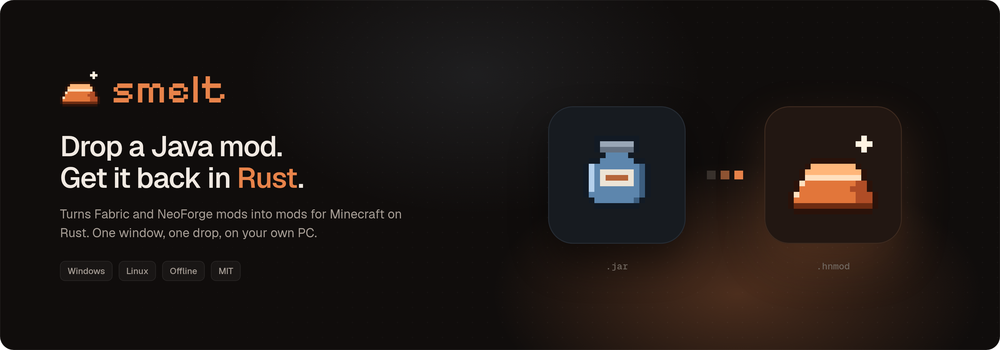
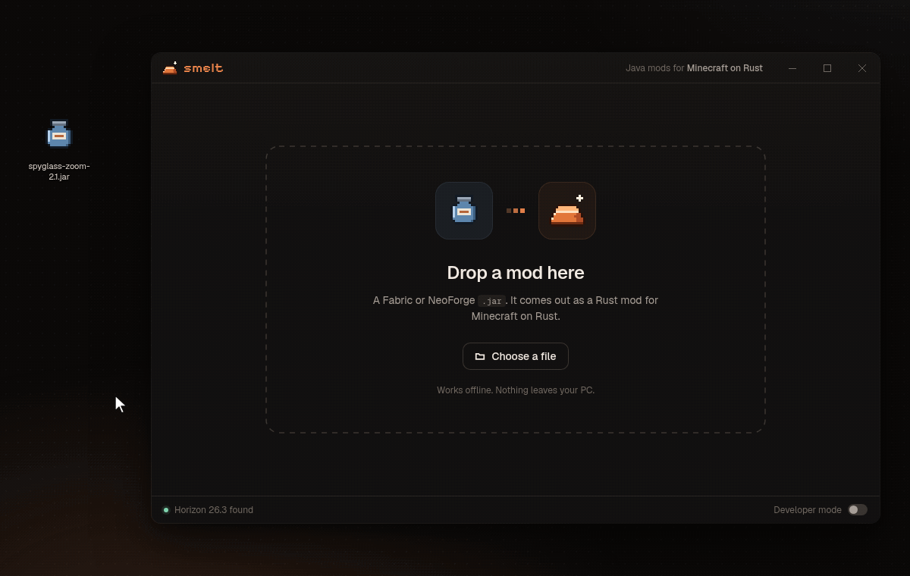
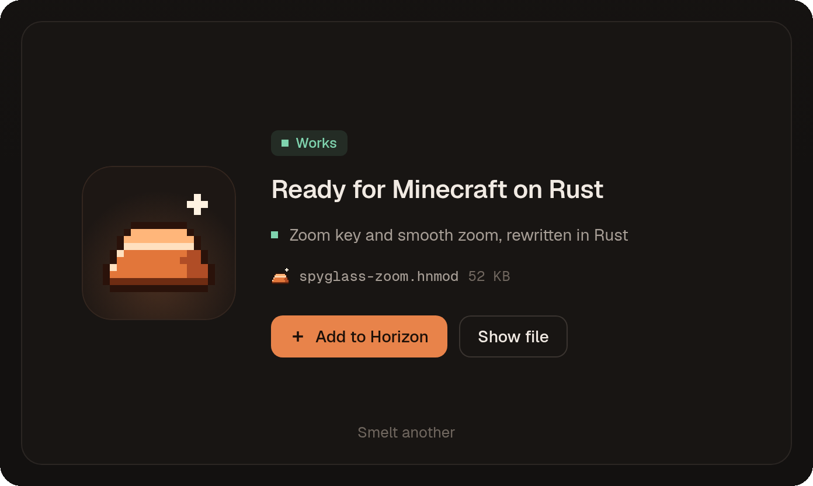
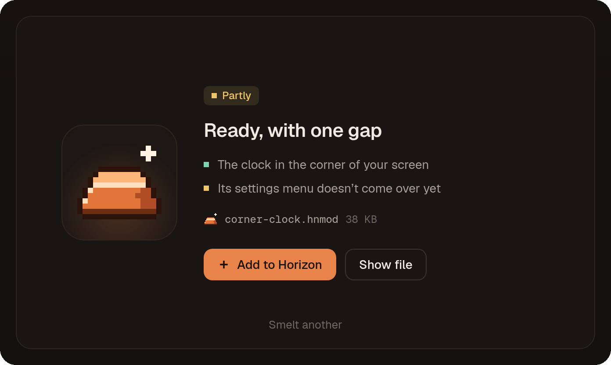
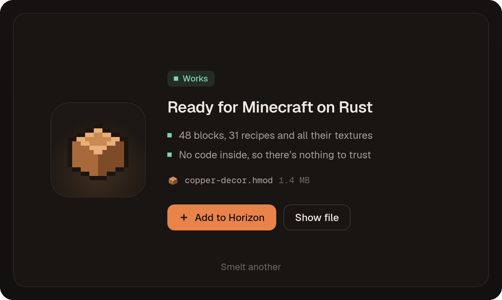
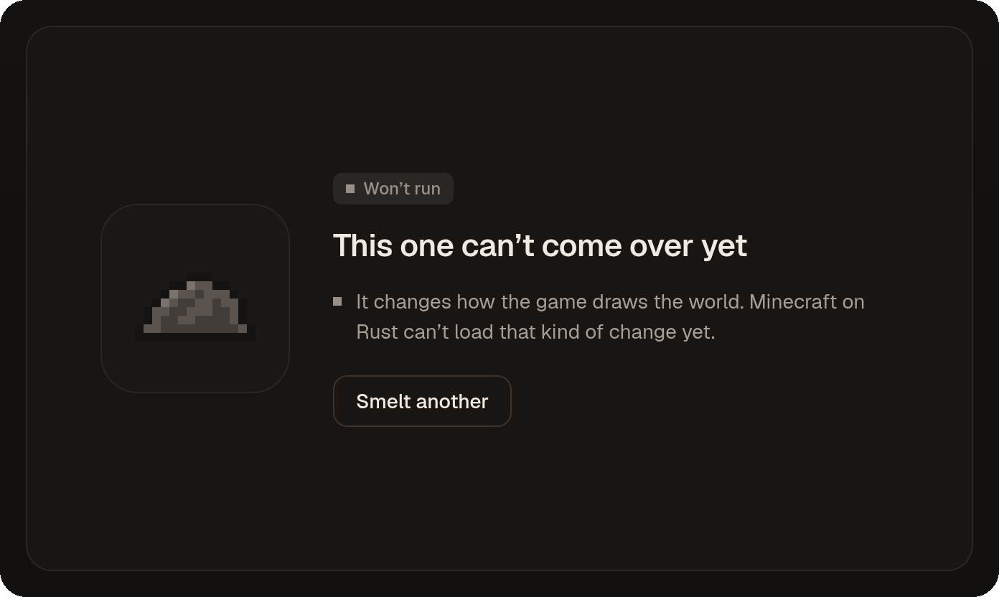
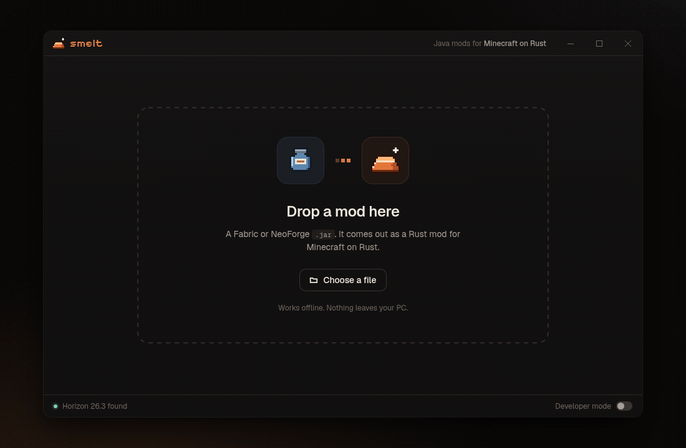
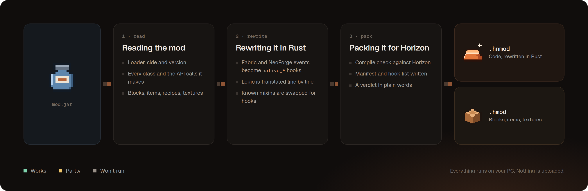
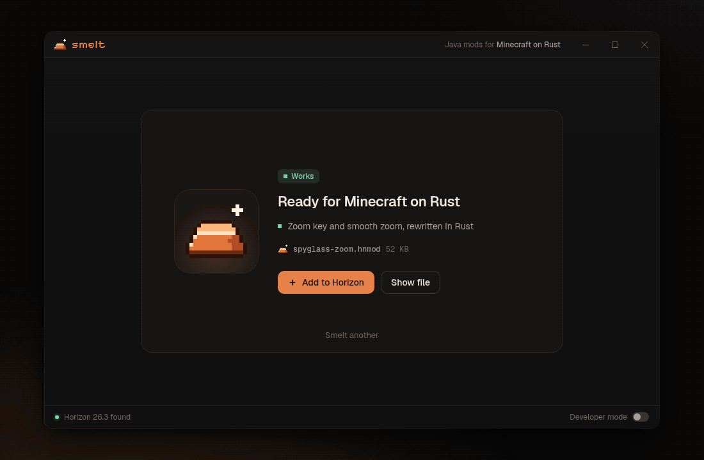
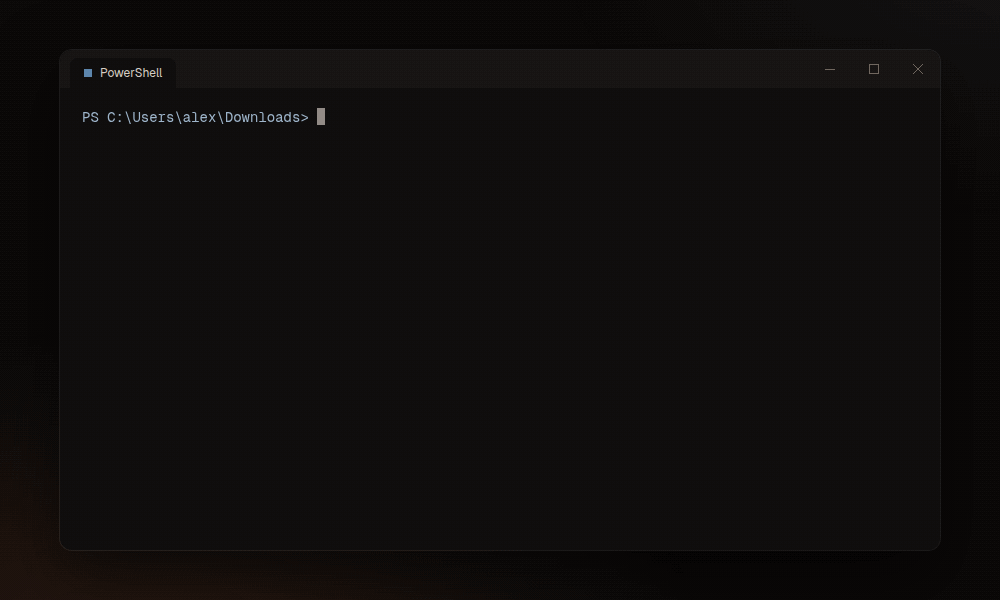

<p align="center">
  
</p>

<p align="center">
  <a href="#download"></a>
  <a href="LICENSE"></a>
  
  
  
</p>

<p align="center">
  <a href="#download">Download</a> ·
  <a href="#how-to-use">How to use</a> ·
  <a href="#what-comes-over">What comes over</a> ·
  <a href="#for-mod-developers">For mod developers</a> ·
  <a href="#faq">FAQ</a>
</p>

<p align="center">
  
</p>

Smelt turns a Fabric or NeoForge mod into a mod for **Minecraft on Rust**: [Horizon](https://github.com/horizon-rust/horizon), the open-source rewrite of Minecraft: Java Edition 26.3. Java mods don't run there. Smelt rewrites them so they do.

Drop the `.jar` on the window, wait a few seconds, press **Add to Horizon**. That's the whole app.

## Download

| System | File | |
|---|---|---|
| Windows 10 and 11 | `Smelt-1.1.21-portable-x64.exe` | One file. No installer, no admin rights |
| Linux (x86_64) | `Smelt-1.1.21-x86_64.AppImage` | `chmod +x`, then run it |

You need Horizon 26.3 on the same PC. Smelt finds it on its own. You don't need Java or a Rust toolchain.

> [!NOTE]
> The Windows build isn't code-signed yet, so SmartScreen may warn you the first time. Choose **More info**, then **Run anyway**.

## How to use

1. Open Smelt.
2. Drop a mod's `.jar` on the window, or press **Choose a file**.
3. Press **Add to Horizon**.

The next time Horizon starts, it asks whether you trust the new mod. That's Horizon's own check for every mod that contains code. Mods made only of blocks and textures don't need it.

<table>
  <tr>
    <td width="50%"></td>
    <td width="50%"></td>
  </tr>
  <tr>
    <td align="center"><sub>A client mod, rewritten in Rust</sub></td>
    <td align="center"><sub>Most of it comes over. The gap is named in one line</sub></td>
  </tr>
  <tr>
    <td></td>
    <td></td>
  </tr>
  <tr>
    <td align="center"><sub>Blocks, recipes and textures. No code, nothing to trust</sub></td>
    <td align="center"><sub>Rendering mods can't come over yet. Nothing is installed</sub></td>
  </tr>
</table>

## What comes over

<p align="center">
  
</p>

Every mod gets one of three verdicts:

| Verdict | What it means |
|---|---|
| **Works** | Everything in the mod runs in Minecraft on Rust. |
| **Partly** | Most of it runs. Smelt tells you which part doesn't, in one line. |
| **Won't run** | The mod does something Minecraft on Rust can't load yet. Nothing gets installed. |

What to expect, by kind of mod:

| Kind of mod | Usually |
|---|---|
| Blocks, items, recipes, loot, textures | Works |
| HUD overlays, keybinds, zoom, chat tweaks, minimaps | Works |
| Settings screens and custom menus | Partly |
| Machines, pipes, new mob behaviour, world generation | Partly or won't run |
| Shaders, rendering engines, performance mods | Won't run |

Smelt doesn't guess. If a piece of a mod can't be rewritten safely, it's left out and the verdict says so. You never get a mod that loads and then breaks your world.

## How it works

<p align="center">
  
</p>

1. **Reading the mod.** Smelt opens the `.jar` and works out the loader (Fabric or NeoForge), the side (client, server or both), every class, and every game API those classes call. Blocks, items, recipes and textures are collected separately.
2. **Rewriting it in Rust.** Loader events become Horizon hook points: `native_tick`, `native_hud`, `native_key`, `native_command` and the rest. Method bodies are translated line by line. Common mixins, like the ones zoom mods use, are swapped for the matching hook.
3. **Packing it for Horizon.** The result is compile-checked against the Horizon revision Smelt targets, then packed. Code goes into a `.hnmod`; blocks, items and textures go into a `.hmod`.

Everything happens on your PC, and nothing is uploaded. The rules that map Java APIs to Horizon hooks are plain TOML files in [`mappings/`](mappings), so anyone can read them and improve them.

## For mod developers

Switch on **Developer mode** in the bottom-right corner to see the Java and the Rust side by side. Matching lines are highlighted, every hook the mod uses is listed, and anything Smelt rewrote from a known pattern is flagged for a quick look.

<p align="center">
  
</p>

From there you can **Export port plan** (a Markdown checklist) or **Open Rust project** to keep working on the generated code yourself.

The same engine runs from the terminal:

<p align="center">
  
</p>

```bash
smelt zoom.jar                         # convert one mod, add it to Horizon
smelt check ./mods                     # verdicts only, nothing written
smelt ./mods --out ./converted         # convert a folder, don't install
smelt zoom.jar --keep-project ./zoom   # keep the generated Cargo project
```

| Option | What it does |
|---|---|
| `--out <dir>` | Write the `.hnmod` and `.hmod` files to a folder instead of Horizon |
| `--keep-project <dir>` | Keep the generated Cargo project for hand editing |
| `--horizon <dir>` | Use a specific Horizon install |
| `--plan <file.md>` | Write the port plan as a Markdown checklist |
| `--json` | Machine-readable verdicts, for CI |

## Build from source

You need Rust 1.85 or newer. The desktop app also needs the [Tauri prerequisites](https://v2.tauri.app/start/prerequisites/) for your system.

```bash
git clone https://github.com/Ropesehypnotize/smelt-minecraft-mods-to-rust-converter.git
cd smelt
cargo build --release -p smelt-cli       # the smelt command
cargo test --workspace
cargo tauri build                        # the desktop app
```

| Path | What's inside |
|---|---|
| `crates/smelt-core` | Reading jars, the Java to Rust rewrite, verdicts |
| `crates/smelt-cli` | The `smelt` command |
| `app/` | The desktop window (Tauri) and its icons |
| `mappings/` | Java API to Horizon hook rules, one TOML file per loader |
| `assets/` | Images for this README |

## FAQ

<details>
<summary><b>Is this made by Mojang or by the Horizon team?</b></summary>

No. Smelt is an independent fan project. It isn't affiliated with Mojang, Microsoft or the Horizon project.
</details>

<details>
<summary><b>Will a converted mod work in normal Minecraft?</b></summary>

No. It's made for Minecraft on Rust only. Keep the original `.jar` for Java Edition.
</details>

<details>
<summary><b>Is it safe?</b></summary>

Smelt works offline and never uploads your mods. Mods with code run unsandboxed in Horizon, so Horizon asks you to trust each one. Only convert mods you would trust on Java Edition too.
</details>

<details>
<summary><b>Can I share a mod I converted?</b></summary>

Check the original mod's license first. A converted mod is still its author's work.
</details>

<details>
<summary><b>My mod says "Won't run". What now?</b></summary>

Usually it changes how the game draws or depends on parts of Java Minecraft that Minecraft on Rust doesn't have yet. Try again after Smelt or Horizon updates. If you think the verdict is wrong, open an issue and attach `smelt check <mod>.jar --json`.
</details>

<details>
<summary><b>Does it handle Forge or Quilt mods?</b></summary>

NeoForge and Fabric today. Quilt mods that only use the Fabric API usually work. Older Forge mods aren't supported.
</details>

## License

Smelt is [MIT](LICENSE) licensed. The bundled fonts, Geist and Pixelify Sans, are under the SIL Open Font License 1.1.

Minecraft is a trademark of Mojang Synergies AB. Smelt isn't an official Minecraft product and isn't approved by or associated with Mojang or Microsoft.
